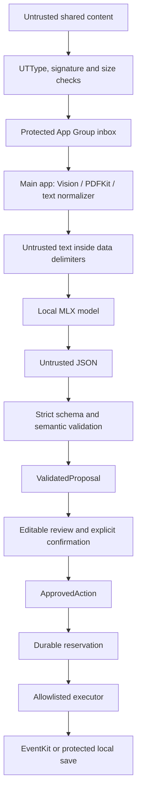

# Architecture

## Trust and execution flow

## Modules

| Component | Responsibility | Capabilities |
|---|---|---|
| `PrivateActionCore` | Types, policy, validation, prompts, model orchestration, protected storage, approval/journal | Foundation + CryptoKit; no network or EventKit |
| Share Extension | One attachment, supported type, bounded copy, metadata removal, inbox publication | App Group only; no MLX dependency |
| ContentProcessor | Bounded OCR/native PDF parsing on a worker task | Vision, PDFKit, ImageIO; no network |
| QwenModelRunner | Load verified local model directory, tokenize, generate bounded JSON | MLX; no application networking or executors |
| ModelManager | Serialize load/generation, retry once, cancel, unload | Abstract LocalLanguageModel only |
| ModelDownloadService | Download reviewed, pinned model assets | Ephemeral HTTPS session; no user-content parameter |
| AppEnvironment | UI state, lifecycle, flow orchestration | Composes concrete components |
| ActionCoordinator | Permission preparation, durable reservation, one approved execution | Abstract ActionExecutor |
| Executors | Create event/reminder or save reviewed content | EventKit or app-private storage |

`ValidatedProposal` is constructed only by core validation and is deliberately not Codable. Stored proposals are decoded as untrusted data and revalidated before exposing action controls. `ApprovedAction` has no public initializer; the confirmation factory validates edited fields and membership in the proposal's action allowlist. The model adapter receives neither a coordinator nor an executor.

## Storage

The App Group contains `Inbox/<UUID>/item.json` and `source.<kind>`. A hidden staging directory is renamed only after both files are written. There is no shared mutable index. The main app updates an item's metadata atomically and removes its raw source after a valid result is committed. Interrupted processing becomes retryable on relaunch. Each filename is derived from a UUID and a closed enum, never from a source filename or generated string.

The main app's Application Support directory contains Models, Saved, ActionJournal and metrics.json. Content, metadata and directories use complete iOS file protection and backup exclusion. Models are also excluded from backup. Model installation uses a staging directory and an atomic publication after verifying the entire expected file set.

`ActionJournal` reserves before side effects. If the process crashes between EventKit save and recording success, the action remains blocked rather than creating duplicates. This provides at-most-once submission, not a distributed exactly-once transaction. The user is told to inspect the destination. Deleting all local data also deletes the journal and all source proposals.

## Dates

The model must leave ISO dates null if the year, timezone or time is absent. Raw date text stays visible. Canonical UTC date strings are round-trip checked. Calendar approval requires an explicit user acknowledgement of the chosen date/time and a writable calendar. Reminder due dates are optional; if used they require acknowledgement. Changing a date clears the checkbox. The initial picker value is only a UI starting value and cannot authorize a calendar action.

## Limits

| Resource | Limit |
|---|---:|
| Share attachments per import | 1 |
| File bytes | 20 MiB |
| Input text | 12,000 characters / 48,000 UTF-8 bytes |
| PDF pages | 10; larger documents rejected |
| Source image pixels | 48 million, each dimension ≤20,000 |
| OCR long edge | 2,048 pixels |
| Prompt including template | 3,072 tokens |
| Output per generation | 512 tokens / validated JSON ≤24,000 bytes |
| Generation deadline | 45 seconds per attempt, checked at token boundaries |
| Regenerations | 1 |
| Inbox | 100 items / 200 MiB source bytes |
| Saved items | 500 |
| Benchmarks retained | 200 records, no input/output text |

## Dependencies

Direct versions are fixed in `project.yml`; transitive revisions are fixed in the Xcode workspace's `Package.resolved`. MLX LM 2.29.3 has explicit Qwen3 support and local-directory tokenization. The selected code path resolves `.directory` locally, including tokenizer configuration. No model repository identifier is passed to MLX at inference time.

A future grammar-constrained runner can implement the same model protocol. Add no model tool calls when making that change. A future model CDN can replace the downloader without changing OCR, prompts, inference or actions.
