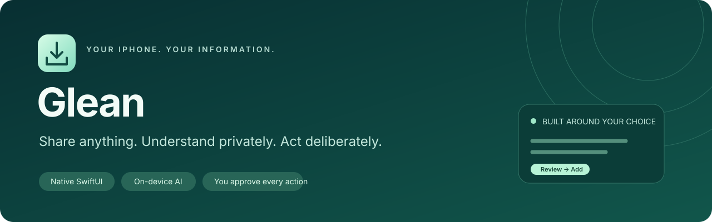
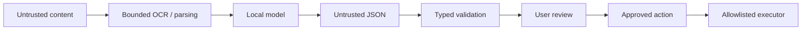

<p align="center">
  
</p>

<p align="center">
  <strong>A private, on-device action inbox for your iPhone.</strong><br />
  SwiftUI · Vision · PDFKit · MLX Swift · Qwen3 · EventKit
</p>

<p align="center">
  <a href="docs/GETTING_STARTED.md">Get started</a> ·
  <a href="ARCHITECTURE.md">Architecture</a> ·
  <a href="SECURITY.md">Security</a> ·
  <a href="BENCHMARKING.md">Device testing</a> ·
  <a href="docs/ROADMAP.md">Roadmap</a>
</p>

> **Prototype — device validation pending.** The Swift core and 48 deterministic security checks passed locally. The MLX adapter, downloader and action executors compiled against the available macOS SDK. The complete iOS app, real model inference and physical iPhone 15 acceptance have **not** been verified. [Full verification record →](BUILD_STATUS.md)

## From a screenshot to something useful

An interview invitation arrives as a screenshot. Share it to Private Action, analyze it locally, and review a summary, a checklist and suggested actions. Confirm the date and destination before adding an event or reminder.

**Share → Understand → Review → Act**

No prompts to write. No chatbot interface. No cloud AI calls.

| Bring in | Understand locally | Choose what happens |
|---|---|---|
| Screenshots and images | Vision OCR | Add a calendar event |
| PDFs | Native text extraction or page OCR | Create a reminder |
| Selected text | Bounded, normalized text | Save a checklist or information |
| Website addresses | Supplied metadata; no webpage fetch | Edit, copy or share a reply draft |

## Built for deliberate actions

- **Private processing.** After model installation, the analysis path uses local files, OCR and inference. No analytics or private content in logs.
- **Your own local model.** Qwen3 1.7B 4-bit is the default: a pinned download of approximately 984 MB. Apple Intelligence is not required.
- **Typed suggestions.** Model output is untrusted JSON, decoded into a strict schema and validated before any action UI appears.
- **Explicit approval.** Review editable fields, choose a destination and confirm. The model cannot send messages, delete events, run code or upload files.
- **Protected storage.** App Group intake, iOS file protection, metadata stripping for images, source expiry and deletion controls.
- **Measured limits.** Bounded files, PDF pages, tokens and generation attempts; cancellation, thermal checks and memory admission checks.

Calendar and Reminders may sync approved content through the account you select. Explicitly sharing a draft also hands that text to your chosen app. These boundaries are shown in the review flow.

## Run on your iPhone

You need full Xcode with support for your device, an Apple signing team with the required App Group capability, and a physical iPhone. The deployment floor is iOS 17; the primary test target is the standard iPhone 15.

1. Clone this repository and open `PrivateAction.xcodeproj`.
2. Configure signing and the **same App Group** for the app and Share Extension.
3. Select your iPhone and run the `PrivateAction` scheme.
4. In the app, open **Settings → Download Local AI Model**.
5. Try **Inbox → + → Add Text**, then **Analyze Locally**.

For shared files: **Share → Private Action → Done**, then open the app manually. The extension never runs the model or bypasses iOS launch restrictions.

[Detailed setup, signing and first-run instructions →](docs/GETTING_STARTED.md)

## The security boundary



**Model intelligence is never authorization.** The prompt is one defensive layer; the validator, action allowlist and confirmation flow enforce the boundary outside the model.

The pinned MLX LM release uses a schema prompt, strict validation and one bounded retry. Token-level grammar constraints are **not implemented** in this version. [Security model and limitations →](SECURITY.md)

## Repository map

```text
App/                     App lifecycle and dependency composition
Views/                   Inbox, analysis, review, saved and settings UI
ShareExtension/          Lightweight Share Sheet intake
Processing/              Vision OCR, PDF parsing and text preparation
AI/                      MLX runner, downloader and synthetic benchmarks
Actions/                 Calendar, Reminder and local-save executors
Core/                    Testable models, validation, storage and authorization
Configuration/           App Groups, Info.plists and entitlements
Resources/               Model integrity catalog, icon and privacy manifest
Tests/iOS/               App-hosted processing tests
Scripts/                 Architecture and repository checks
.github/                 CI, issue forms and pull request template
docs/                    Setup, roadmap and repository artwork
ThirdPartyNotices/       Dependency and model notices
```

`project.yml` is the XcodeGen source; the generated Xcode project and exact dependency lockfile are committed. Model weights, credentials, user content and build products are excluded.

## Validate changes

```sh
swift build --package-path Core
swift run --package-path Core SecurityChecks
python3 Scripts/check_boundaries.py
python3 Scripts/check_repository.py
```

With full Xcode installed:

```sh
swift test --package-path Core
```

GitHub Actions runs core tests and policy checks on pull requests and pushes to `main`. A separate manual workflow compiles the unsigned iOS app. Neither CI nor mocked unit tests establish real-model quality, physical memory behavior or airplane-mode acceptance. Follow the [device test protocol](BENCHMARKING.md) for those gates.

## Documentation

| Guide | Purpose |
|---|---|
| [Getting started](docs/GETTING_STARTED.md) | Xcode, signing, installation and first analysis |
| [Architecture](ARCHITECTURE.md) | Components, storage, dates and resource limits |
| [Security](SECURITY.md) | Trust boundaries, reporting and known limitations |
| [Benchmarking](BENCHMARKING.md) | Synthetic suite and physical-device acceptance |
| [Build status](BUILD_STATUS.md) | What has actually been checked |
| [Roadmap](docs/ROADMAP.md) | Remaining prototype and release gates |
| [Contributing](CONTRIBUTING.md) | Development workflow and review expectations |
| [Model licenses](MODEL_LICENSES.md) | Model revisions, attribution and dependency notices |
| [Original brief](SPECIFICATION.md) | Product requirements |

## Project status and licensing

This repository is a private prototype. No open-source license has been selected for the original application code. Third-party components and model weights retain their respective licenses; see [MODEL_LICENSES.md](MODEL_LICENSES.md). No production release or device performance claims are made.
